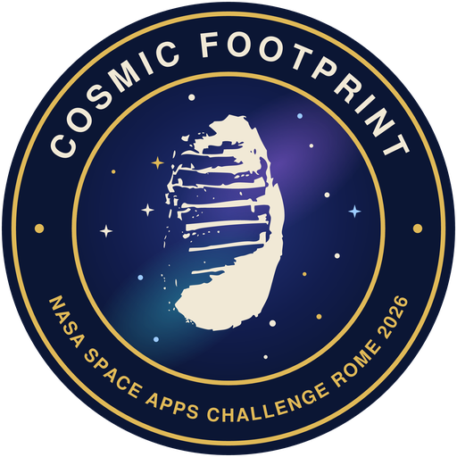

<p align="center"></p>

# Cosmic Footprint Detector

**NASA Space Apps Challenge 2026 · Rome · "Planet X and SPHEREx" · team Cosmic Footprint**

A web tool that explores the real images of NASA's **SPHEREx** space telescope and finds what moves
in them: nearby stars with a large proper motion, brown dwarfs, asteroids. Every candidate can be
cross-checked against independent public data (Gaia DR3 and CSA's NEOSSat) directly in the page.

## Run it
```bash
pip install -r requirements.txt
python -m src.web_server        # then open http://localhost:8000/explore.html
```
On Windows, double-click `riavvia.bat` (it closes any previous server and starts a new one).
`python -m src.web_server --demo` runs with synthetic images and no network.

## What it does
1. **Fly over the sky** around a target. Each sector is a short "blink" movie of the SPHEREx
   images, re-aligned with each file's WCS.
2. **PING** compares all images and marks objects that moved (proper motion or jumps),
   with an estimate of how many false alarms chance alone would give.
3. **Cross-checks**
   - *Gaia DR3* (MAST): is there a catalogued star with the same proper motion? Gaia hunter
     lists fast, faint or nearby stars; stars Gaia sees but SPHEREx cannot detect are shown
     with a warning instead of being hidden.
   - *SPHEREx spectrum* (6 detectors, 0.75-5 um) of each candidate and a simple star / cold-object verdict.
   - *NEOSSat* (CSA, via CADC): real optical images taken in other years; the predicted position
     (Gaia + proper motion) is verified on the pixels after a plate solution.
   - *Time machine*, *twins* (common proper motion) and a printable *report*.
4. **Simple mode** (button in the header): fewer controls and plain-language explanations.
   **Challenge mode** (Hunt tab): pick a Gaia star, press PING and see how close the measured
   proper motion is to Gaia's.

English and Italian interface (EN | IT). All texts live in `public/js/i18n.js`.

## Data sources (only these)
| Source | Use |
|---|---|
| NASA/IPAC IRSA - SPHEREx (TAP, SIA2, AWS bucket `nasa-irsa-spherex`) | images and metadata |
| SPHEREx tutorial notebooks (IRSA) | cutout / spectrum methods |
| Gaia DR3 via MAST / STScI (VO TAP) | proper motions, parallaxes, cross-match |
| CSA NEOSSat, via the CADC archive (TAP + public files) | independent images in other years |
| WiseView | inspiration for the blink approach (no data used) |

## How images arrive quickly
The server reads SPHEREx FITS files straight from the public AWS bucket with HTTP Range requests
(header ~26 KB + only the rows needed, ~1 MB) instead of IRSA's cutout service (~4 MB, 3-10 s). The
result was checked pixel by pixel against a real IRSA cutout. Everything is cached in `data/`.
If IRSA does not answer, the saved copy is used and the page says so.

## Project layout
```
src/       web_server.py (server + API), api_client.py (IRSA), s3_cutout.py, neossat.py, prefetch.py
public/    the website: explore.html, css/, img/ (logo), js/ (i18n, fits, wcs, align, detect, drift,
           tags, guide, report, explorer, workers), data/missions.json
tests/     pytest (server, IRSA client) and tests/js (node: drift, tracks, WCS)
docs/      API.md, ARCHITECTURE.md
cloudflare/ optional edge Worker for fast cutouts
```

## Tests
```bash
python -m pytest
node tests/js/check_drift.js
```

## Honest limits
- Very faint or very red objects (e.g. WISE 0855) are close to SPHEREx's noise floor.
- NEOSSat windows are small (~0.2 deg) and have no WCS; the plate solution is estimated from Gaia stars.
- Stars brighter than G~7 saturate in SPHEREx.

## Also in this version
- **Pixel flags**: the SPHEREx `FLAGS` extension is read next to every image; frames with flagged pixels at the target (hot, ghost, streak, bloom...) are marked in the frame info.
- **AllWISE layer** (IRSA): sources with proper motion are drawn as green squares with arrows, next to the Gaia DR3 layer.

 

## AI assistance
AI in this project was used for:
- writing and debugging help (Python server, JavaScript front end, CSS);
- writing and translating texts (EN/IT interface, documentation);
- building the slide presentation.

No images were generated by AI: every image in the app and in the slides is a screenshot of the app running on real NASA data, or the team's own logo.
The app itself does not contain any AI or machine-learning model.
All decisions, testing and the final review were done by the team.
